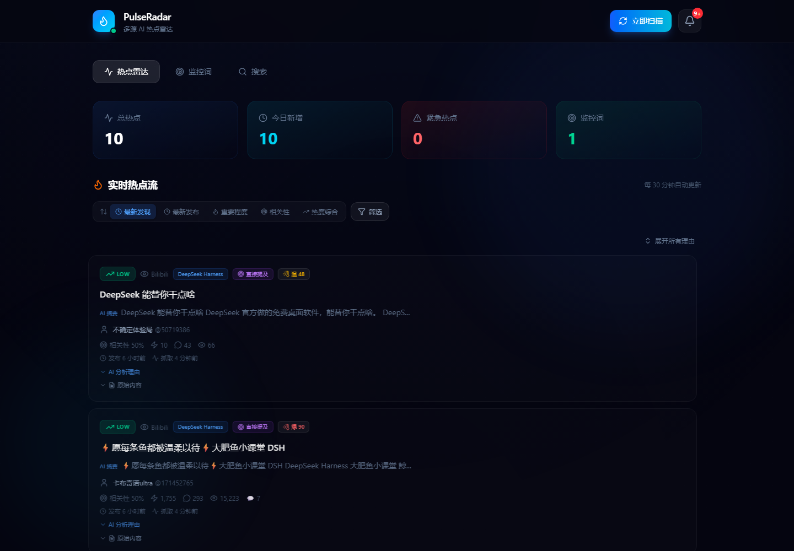
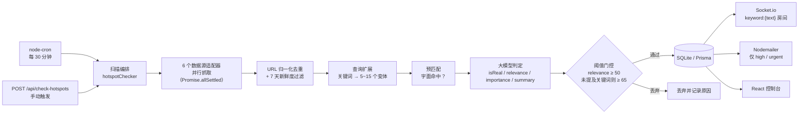

# PulseRadar · 多源 AI 热点雷达

> 给几个技术关键词，每 30 分钟自动扫一遍中英文 6 个信息源，用大模型判断「是不是真的、跟我关心的东西有多相关」，只有真正相关的才推到你面前。




## 为什么做这个

AI 领域的信息密度太高了：新模型、新工具、新版本几乎每天都在发，散落在 Twitter、Hacker News、微博、B 站、搜索引擎里。手动刷一遍至少半小时，还大量重复和标题党。

我需要的不是「再收藏一个网页」，而是一个**只在真的相关时才来打扰我**的雷达。PulseRadar 就是按这个目标做的：把「多源抓取 → 去重 → 相关性判定 → 分级推送」整条链路自动化，并把「相关性判定」交给大模型，而不是简单的关键词包含。

## 核心能力

| 能力          | 说明                                                            |
| ----------- | ------------------------------------------------------------- |
| 监控词管理       | 增删改、启停、按词统计热点数；定时任务只扫激活的词                                     |
| 多源聚合        | Twitter / Bing / Hacker News / 搜狗 / B 站 / 微博，六源并行抓取，单源失败不影响整体 |
| 账号识别        | 如果监控词正好是某个 B 站 UP 主，直接抓 TA 的最新视频，而不是泛搜                        |
| 三层过滤        | 查询扩展预匹配 → 大模型结构化判定 → 阈值门控，拦掉同领域但无关的内容                         |
| 去重与新鲜度      | URL 归一化去重 + 数据库唯一索引 + 7 天新鲜度窗口                                |
| 多维筛选        | 按来源、重要性、时间范围、是否真实筛选；按热度、相关性、时间排序                              |
| 实时推送        | Socket.io 按关键词分房间推送，命中高/紧急的再发邮件                               |
| Agent Skill | 同一套抓取能力封装成 Python 脚本包，Cursor / Claude Code / Copilot 可直接调用    |

## 技术栈

| 层  | 选型                                                                                 |
| -- | ---------------------------------------------------------------------------------- |
| 前端 | React 19 · Vite 7 · TypeScript · Tailwind CSS 4 · Framer Motion · Socket.io Client |
| 后端 | Node.js 20+ · Express 5 · TypeScript（ESM）                                          |
| 数据 | Prisma 6 · SQLite                                                                  |
| AI | OpenRouter（默认 `deepseek/deepseek-v3.2`，模型可配）                                       |
| 采集 | Axios + Cheerio（HTML 解析）· Hacker News Algolia API · twitterapi.io                  |
| 任务 | node-cron（默认每 30 分钟，可配 cron 表达式）                                                   |
| 通知 | Socket.io · Nodemailer                                                             |
| 工程 | pnpm workspace · Vitest · GitHub Actions · Docker Compose                          |

## 架构



一次扫描的完整流程、各层为什么这么设计，见 [docs/ARCHITECTURE.md](docs/ARCHITECTURE.md)。

## 几个关键设计

**1. 召回和判定分开，别让模型干搜索的活**

先用模型把监控词扩展成 5~15 个检索变体（大小写、空格、中英文对照、缩写），再做字面预匹配；这一步很便宜，能把明显无关的内容挡在模型调用之前。模型只负责它擅长的部分：判断真假、打分、写摘要。

**2. 把预匹配结果喂回模型，抑制「同领域不同主题」的误判**

纯语义打分最常见的翻车场景：监控 `Claude Sonnet 4.6`，结果把 `GPT-5 发布` 判成 85 分。做法是把「正文里到底有没有出现关键词变体」作为提示注入 Prompt，并配合硬阈值（未提及关键词时相关性必须 ≥ 65 才保留）。这条规则来自评测集里反复出现的失败样例。

**3. 结构化输出 + 三级降级，扫描永远不中断**

模型返回必须是可解析的 JSON；解析失败、超时、无 Key 三种情况都走规则降级（按预匹配结果给基础分），而不是抛异常中断整轮扫描。降级逻辑本身有单测覆盖。

**4. 幂等与「单飞」**

URL 归一化去重 + `@@unique([url, source])` + 落库前查重，保证同一条内容不会重复入库、重复推送。扫描入口加了单飞锁：定时触发和手动触发同时发生时，后来的那次直接跳过，避免叠加抓取把数据源刷出频率限制。

**5. 实时推送的房间模型**

客户端订阅自己的激活关键词，服务端按 `keyword:{text}` 分房间 emit，只把匹配的热点推给关心它的人；同时有一条全局通知流给前端做角标。

**6. 把用量记录成可观测数据**

每次模型调用都记录模型名、Prompt 版本、延迟、prompt/completion token 数，汇总在 `GET /api/health` 里。调 Prompt 时能直接看到「效果变了多少、成本涨了多少」。

## 项目结构

```
pulse-radar/
├── client/                     # React 控制台
│   └── src/
│       ├── App.tsx             # 页面骨架、状态与数据流
│       ├── components/         # 筛选栏、卡片、UI 特效
│       ├── services/           # REST 封装 + Socket 客户端
│       └── utils/              # 排序、相对时间
├── server/                     # Express API
│   ├── prisma/                 # schema + 迁移
│   └── src/
│       ├── routes/             # keywords / hotspots / notifications / settings
│       ├── services/           # ai / prompts / search / chinaSearch / twitter / email
│       ├── jobs/               # 定时扫描编排
│       ├── utils/              # 排序等纯函数
│       └── __tests__/          # 单测 + AI 评测集
├── skills/pulse-radar/         # Agent Skill：无服务端的 Python 抓取脚本包
├── docs/                       # 架构、API、AI 链路、本地运行、需求验收
├── .github/workflows/ci.yml    # typecheck → test → build
└── docker-compose.yml
```

## 快速开始

前置：Node.js ≥ 20、pnpm ≥ 10、一个 [OpenRouter API Key](https://openrouter.ai/settings/keys)（不填也能跑，会走规则降级）。

```bash
pnpm install

# 配置环境变量（从示例复制，填入自己的 Key）
cp server/.env.example server/.env

# 生成 Prisma Client 并初始化数据库
pnpm db:generate
pnpm db:push

# 同时启动前后端（API :3001，Web :5173）
pnpm dev
```

打开 <http://localhost:5173> ，输入 `Claude Sonnet` 之类的关键词，点「手动扫描」即可。

环境变量说明与常见问题见 [docs/LOCAL\_SETUP.md](docs/LOCAL_SETUP.md)。

## 测试与 CI

```bash
pnpm test         # 服务端单测（42 passed / 11 skipped，跳过的是需要真实 API Key 的 AI 评测）
pnpm typecheck    # 前后端类型检查
pnpm build        # 服务端 tsc + 前端 vite build
```

测试覆盖三类内容：排序与热度计算的纯函数、查询扩展与预匹配的确定性行为、AI 降级逻辑；另有一套 11 例的相关性评测集，配置 `OPENROUTER_API_KEY` 后会真实调用模型，校验分数落在预期区间，用于 Prompt 改动的回归。

CI 在每次 push / PR 上跑 `typecheck → test → build`，用 `prisma db push` 建一个临时 SQLite 库。

## 已知限制

- **单用户**：没有登录与鉴权，默认只给自己用；多用户需要加租户字段与鉴权中间件。
- **SQLite 单文件**：适合个人规模（万级记录），并发写入多了会锁；换 Postgres 只需改 datasource 与迁移。
- **抓取依赖 HTML 结构**：搜索引擎改版会导致解析失效，需要定期维护选择器；Twitter 依赖第三方 API Key。
- **失败重试是粗粒度的**：目前靠下一轮 cron 兜底，没有独立的任务队列与死信。

## Roadmap

- [ ] 鉴权 + 多用户（JWT / 会话，按用户隔离监控词）
- [ ] 数据源适配器插件化：统一 `SourceAdapter` 接口 + 注册表，新增来源不改编排代码
- [ ] 抓取失败自动退避与熔断，暴露 per-source 成功率指标
- [ ] 语义去重（SimHash / embedding）替代纯 URL 去重
- [ ] 前端长列表虚拟滚动 + 骨架屏
- [ ] 邮件发送重试与发送记录

## 文档

| 文档                                           | 内容                    |
| -------------------------------------------- | --------------------- |
| [docs/ARCHITECTURE.md](docs/ARCHITECTURE.md) | 分层、数据流、关键取舍与失败模式      |
| [docs/API.md](docs/API.md)                   | REST 接口与 WebSocket 事件 |
| [docs/AI\_PIPELINE.md](docs/AI_PIPELINE.md)  | Prompt 设计、评测方法、成本控制   |
| [docs/LOCAL\_SETUP.md](docs/LOCAL_SETUP.md)  | 从零跑起来 + 常见问题          |
| [docs/REQUIREMENTS.md](docs/REQUIREMENTS.md) | 需求与验收标准               |

## License

[MIT](LICENSE)
